# 🚦 Integrated Traffic Management System Using AI (ITMSAI)

An AI-powered Integrated Traffic Management System designed to improve urban traffic flow through computer vision, intelligent vehicle detection, adaptive traffic signal control, Automatic Number Plate Recognition (ANPR), and a Cyber Crime Reporting and Management Hub.

The project has evolved through three development stages, progressing from an initial AI-based traffic management implementation to a simulated integrated dashboard and finally to a comprehensive system implementation.

---

## 📌 Project Evolution

| Version | Development Stage | Description |
|---|---|---|
| V1 | Initial Implementation | AI-based vehicle detection, lane-wise counting and dynamic traffic signal control. |
| V2 | Simulation & Prototype | Animated traffic intersection and frontend simulation demonstrating the intended integrated system experience. |
| V3 | Integrated Implementation | Comprehensive system integrating AI detection, traffic control, ANPR, authentication, database services and Cyber Crime Hub. |

### Version 1 — Initial Implementation

The initial implementation focused on:
- Multi-lane vehicle detection using YOLO and OpenCV.
- Vehicle counting and traffic density estimation.
- Dynamic traffic signal allocation.
- Raspberry Pi Pico-based traffic light control.
- Initial ANPR and crime reporting functionality.

### Version 2 — Simulation & System Prototype

Version 2 demonstrates how the integrated traffic management system would appear and behave when its different components are brought together.

Key components:
- Animated four-way traffic intersection.
- Simulated vehicle movement across multiple lanes.
- Lane-wise vehicle counting and congestion monitoring.
- Visual representation of adaptive traffic signals.
- Simulated hardware traffic-light interface.
- Dashboard layout representing the intended integrated system.

**Objective:** Validate the visual design, interaction flow and proposed integration of the traffic management components before implementing the complete system.

### Version 3 — Integrated System Implementation

Version 3 extends the prototype into a comprehensive application.

Major components:

**1. AI-Based Traffic Management**
- YOLO-based vehicle detection.
- Real-time video processing.
- Lane-wise vehicle tracking and counting.
- Traffic density classification.
- Adaptive traffic signal allocation.
- Traffic history and monitoring.

**2. Traffic Signal Integration**
- Raspberry Pi Pico W integration.
- Wokwi hardware simulation.
- Four-lane traffic-light control.
- Signal-state monitoring.
- Manual signal override and adaptive control.

**3. Automatic Number Plate Recognition (ANPR)**
- Vehicle and number plate detection.
- Number plate recognition using OCR.
- Image and video processing.
- Original and annotated detection results.
- Searchable recognition history.

**4. Cyber Crime Hub**
- Citizen incident reporting.
- Complaint and evidence management.
- Case status tracking.
- Location-based incident mapping.
- Emergency contact information.
- Administrative case management.

**5. Authentication and Administration**
- User registration and login.
- Role-based access.
- Administrator dashboard.
- User and session management.
- Security audit logs.

---

## 🏗️ System Architecture

The integrated system consists of the following major components:

```text
                ITMSAI
                   |
       +-----------+-----------+
       |           |           |
   Traffic       ANPR       Cyber Crime
   Management   Module         Hub
       |           |           |
   Video Input  Image/Video  Incident Reports
       |           |           |
   YOLO + CV    Plate Detection  Database
       |           |           |
   Lane-wise    OCR          Case Management
   Counting       |              |
       |       ANPR Records    Admin Panel
       |
   Density Analysis
       |
   Adaptive Signal Controller
       |
   Raspberry Pi Pico W
       |
   Traffic Light Simulation
       |
   Dashboard Monitoring
```

---

## 🛠️ Technology Stack

| Category | Technologies |
|---|---|
| Programming Language | Python |
| Backend | FastAPI |
| Computer Vision | OpenCV, YOLO |
| AI Model | ONNX Runtime |
| Number Plate Recognition | OCR, Tesseract |
| Database | MongoDB |
| Frontend | HTML, CSS, JavaScript |
| Hardware | Raspberry Pi Pico W |
| Hardware Simulation | Wokwi |
| Containerization | Docker, Docker Compose |
| Development | VS Code, Git, GitHub |

---

## 📊 Key Capabilities

- AI-powered multi-lane vehicle detection.
- Adaptive traffic signal management.
- Real-time traffic visualization.
- Hardware and simulation integration.
- Automatic Number Plate Recognition.
- Traffic monitoring and historical records.
- Citizen crime reporting.
- Incident mapping and case management.
- Secure authentication and administration.

---

## 🎯 Project Objectives

1. Reduce unnecessary vehicle waiting time through adaptive traffic signals.
2. Improve traffic monitoring using computer vision.
3. Integrate software-based traffic intelligence with hardware simulations.
4. Automate vehicle number plate recognition.
5. Provide a centralized platform for incident reporting and management.
6. Develop a modular system that can be extended for real-world traffic applications.

---

## 📸 Project Demonstrations

Screenshots and demonstrations from the three development stages will be maintained in the repository.

- Version 1 — Initial implementation.
- Version 2 — Simulated integrated dashboard.
- Version 3 — Comprehensive system implementation.

---

## Screenshots & Application Preview

The following screenshots showcase the ITMSAI application, including its traffic management, ANPR, Cyber Crime Hub, administrator features and Wokwi-based traffic-light simulation.

<table>
<tr>
<td align="center"><strong>Home Dashboard</strong><br>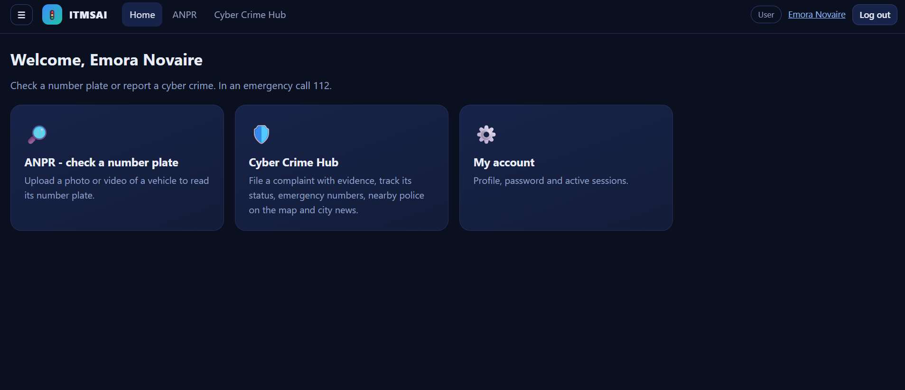</td>
<td align="center"><strong>ANPR – Image Upload</strong><br>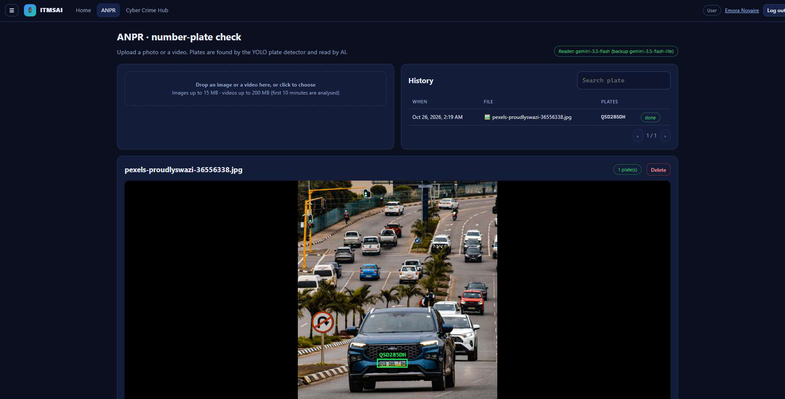</td>
</tr>
<tr>
<td align="center"><strong>ANPR – Number Plate Recognition</strong><br>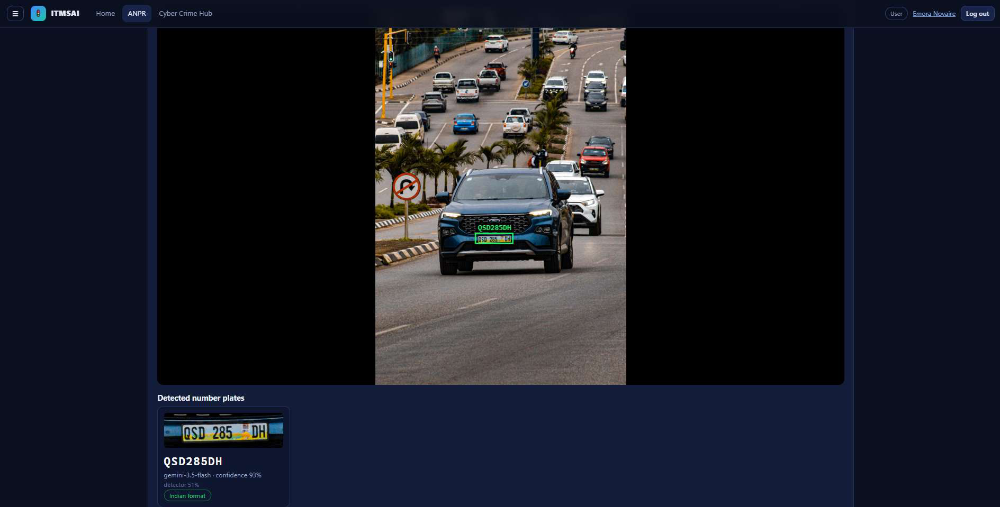</td>
<td align="center"><strong>Cyber Crime – Report Submission</strong><br>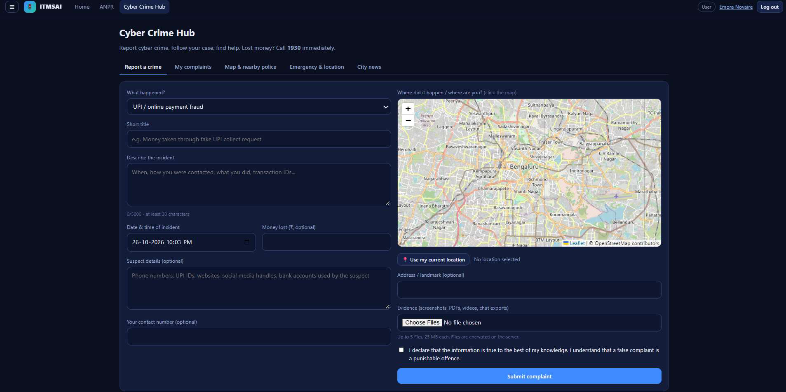</td>
</tr>
<tr>
<td align="center"><strong>Cyber Crime – My Complaints</strong><br>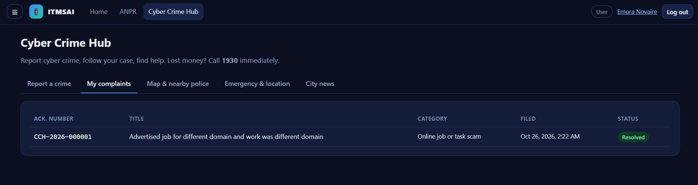</td>
<td align="center"><strong>Cyber Crime – Complaint Details & Timeline</strong><br>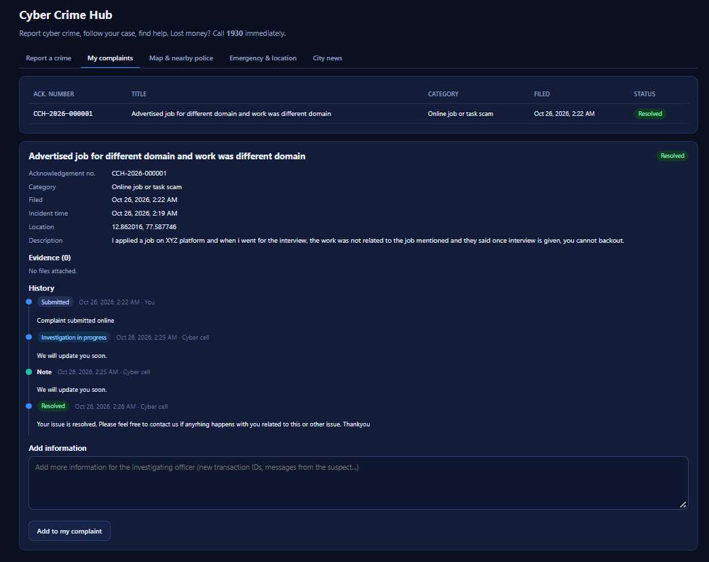</td>
</tr>
<tr>
<td align="center"><strong>Cyber Crime Hub – City News</strong><br>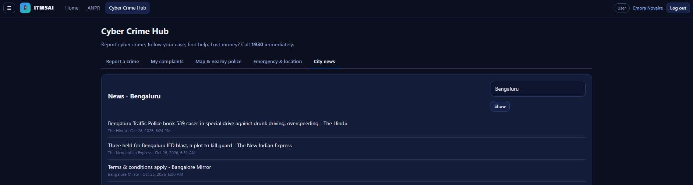</td>
<td align="center"><strong>User Profile & Account Settings</strong><br>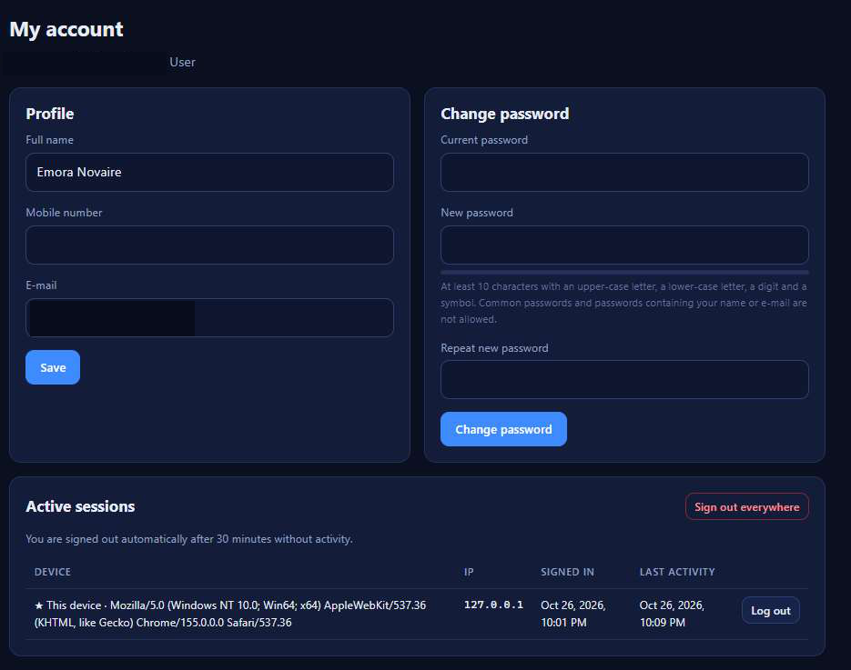</td>
</tr>
<tr>
<td align="center"><strong>Administrator Dashboard</strong><br>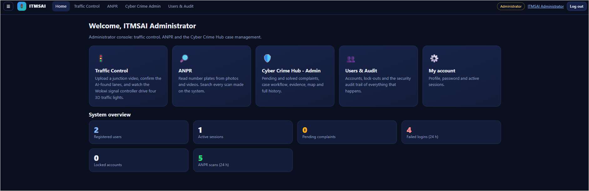</td>
<td align="center"><strong>AI Traffic Control & Wokwi Signal Status</strong><br>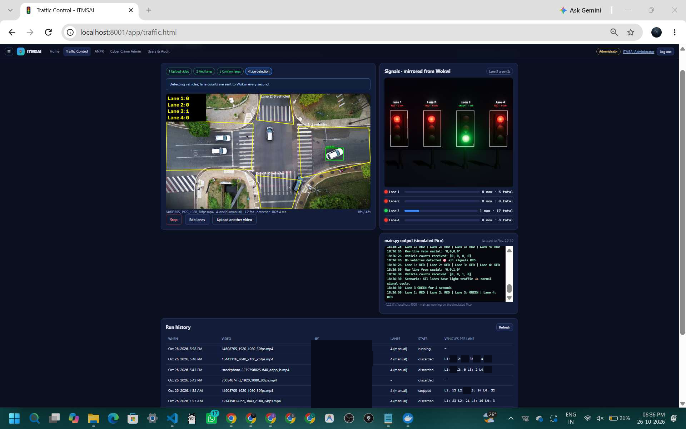</td>
</tr>
<tr>
<td align="center"><strong>ANPR – Video Detection Results</strong><br>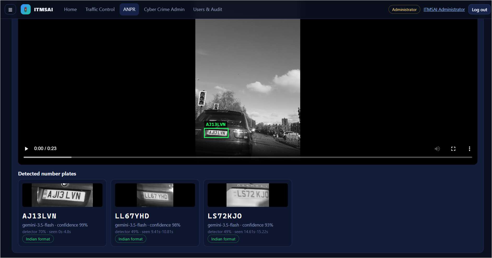</td>
<td align="center"><strong>Wokwi Simulation & Vehicle Detection</strong><br>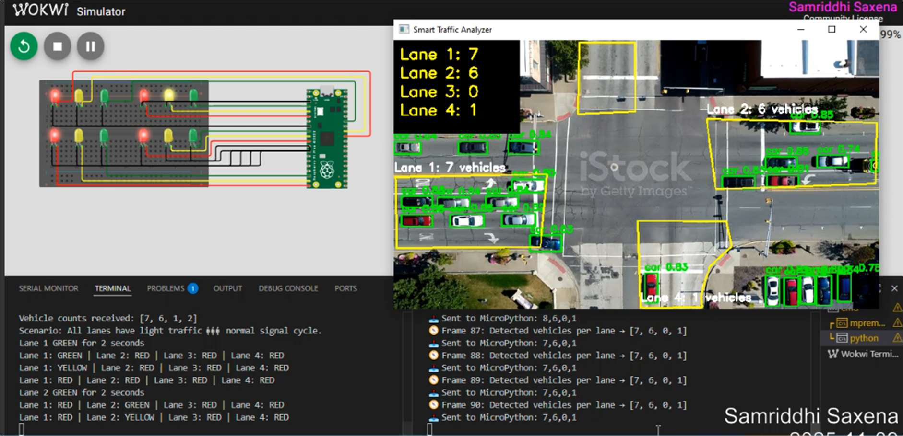</td>
</tr>
</table>


## 👩‍💻 Developer

**Samriddhi Saxena**

BE — Computer Science and Engineering (Data Science)  

---

## 📜 License

This project is licensed under the GNU Affero General Public License v3.0. See [LICENSE.md](LICENSE.md) for details.
